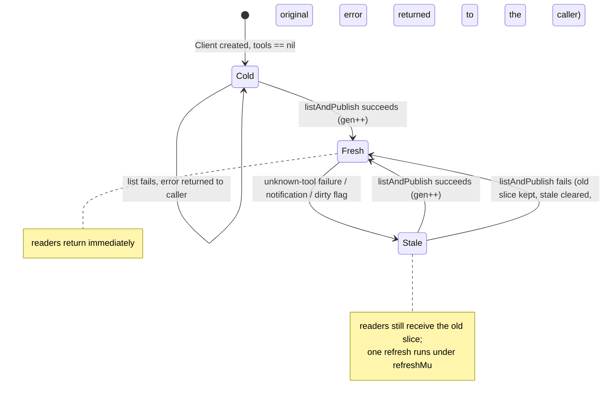

# Data Model: MCP Tool Catalog Refresh

All state is in-process. There is no persisted store and no schema migration.

---

## Entity: Tool Catalog (existing, extended)

One instance per `Client`, therefore per configured MCP server.

| Field | Type | Guard | Purpose |
|---|---|---|---|
| `tools` | `[]Tool` | `mu` | Last known-good catalog, with `<serverID>_` prefixes. Never set to `nil` after the first successful list. |
| `toolsStale` | `bool` | `mu` | The catalog is known to disagree with the server. Readers still serve `tools`. |
| `toolsDirty` | `atomic.Bool` | none | Set only by the `ToolListChangedHandler`. Consumed by the next successful publication. |
| `catalogGen` | `uint64` | `mu` | Incremented on every successful publication. Lets a queued caller detect that someone else already refreshed. |
| `refreshMu` | `sync.Mutex` | — | Single-flight for the refresh. Never acquired while holding `mu`. |
| `lastRefresh` | `time.Time` | `refreshMu` | Time of the last successful re-list. Bounds the failure-triggered refresh rate. |
| `listTools` | `func(context.Context) ([]Tool, error)` | set once | Test seam. Defaults to the real transport dispatch. Nil means "use the real path". |

`Tool` is unchanged (`pkg/mcp/types.go:40`): `Name`, `Title`, `Description`, `InputSchema`, `OutputSchema`, `Annotations`.

**Invariants**

1. `tools` is written only under `mu.Lock()` and read only under `mu.RLock()` or after copying the slice header under `RLock`.
2. Entries inside a published slice are never mutated. A new slice is built for each publication.
3. The only permitted lock order is `refreshMu` then `mu`. No path acquires `refreshMu` while holding `mu`. `markToolsStale`, `clearToolsStale`, and `catalogGeneration` take `mu` and are never called from a path that already holds `mu`.

**State transitions**



The transition `Stale --> Fresh` on failure is deliberate. A server that is unreachable must not force a re-list on every subsequent call: the failure clears the stale flag, and only a new unknown-tool failure (or a new notification) re-arms it.

---

## Entity: Refresh Attempt

| Field | Type | Purpose |
|---|---|---|
| `sinceGen` | `uint64` | The `catalogGen` observed before the failed call. Zero means "no generation to compare" (cold start, reader, or notification path). |
| `lastRefresh` | `time.Time` | Compared against `toolCatalogRefreshMinInterval`. |
| outcome | `(refreshed bool, err error)` | `refreshed` is true when the caller should retry the tool call. |

**Decision table**

| Condition | Action | Result |
|---|---|---|
| `sinceGen != 0` and `catalogGen != sinceGen` | None. Another caller already refreshed. | `(true, nil)` — retry |
| `sinceGen == 0` and catalog is fresh (`tools != nil`, not stale, not dirty) | None | `(true, nil)` — no re-list |
| `sinceGen != 0` and `tools != nil` and `now - lastRefresh < 30s` | None | `(false, nil)` — rate limited, no retry |
| otherwise | Mark stale, `listAndPublish` | `(true, nil)` on success |
| `listAndPublish` fails, or the fetched catalog is empty | Clear stale, keep old slice | `(false, err)` |

**Validation rules**

| Rule | Requirement |
|---|---|
| At most one re-list per server per 30s after a failure | FR-006, SC-003 |
| Concurrent failures coalesce into one re-list | FR-005, SC-002 |
| A failed re-list keeps the previous catalog and returns the original error | FR-004 |
| An empty re-list result is a failed re-list: the previous catalog is kept and nothing is published | FR-004, FR-007, edge case |
| Only MCP transports refresh. An `openapi` client returns the original error with no hint | FR-011 |
| A failed re-list does not change health status | FR-008 |
| Callers never see an empty catalog while a refresh runs | FR-007 |
| A refresh and its retry never apply to an OpenAPI server | FR-011 |
| Refreshed names keep the `<serverID>_` prefix | FR-013 |
| At most one retry per call | FR-003 |
| `tools/list` timeout stays at 10s | existing rule 27 in 106 |

---

## Entity: Unknown-tool Hint

Built only when a successful re-list is followed by a retry that fails again. Never built when the refresh was refused (rate limited) or failed, because the catalog did not change and the hint would repeat the name that just failed.

| Field | Source | Rule |
|---|---|---|
| `failedName` | the prefix-stripped name passed to `callMCPToolWithContext` | Echoed verbatim in the message, and excluded from `candidates` after the same prefix strip |
| `serverID` | `c.config.ID` | Echoed verbatim |
| `candidates` | entries of `c.tools`, prefix stripped | Max 8, ranked by shared `_`-delimited tokens with `failedName` |
| `total` | `len(c.tools)` | Used for the `(N more)` tail, which appears whenever `total > 8` |

**Message shape**

```text
unknown tool "alerting_manage_rules" on server mcp-grafana; this server now provides: alerting_rules_read, alerting_alertmanager_read
```

The result is wrapped with `%w` around the original error, so `errors.Is`, `errors.As`, and `mcp.ClassifyError` keep working. `ClassifyError` still returns `ErrKindProtocol`, so the agent still tags the span `mcp.error_kind=protocol` (`pkg/agent/loop.go:990`).

---

## Entity: Catalog Change Notification (input only)

| Field | Type | Rule |
|---|---|---|
| method | `notifications/tools/list_changed` | Delivered only on transports that keep a server-initiated stream (SSE) |
| handler | `mcpsdk.ClientOptions.ToolListChangedHandler` | Writes `toolsDirty` only; takes no lock; does no I/O |

No persistent entity. The notification is a hint, not a contract. FR-016 keeps standalone SSE disabled, so `streamable-http` servers never deliver it and rely on US1.
